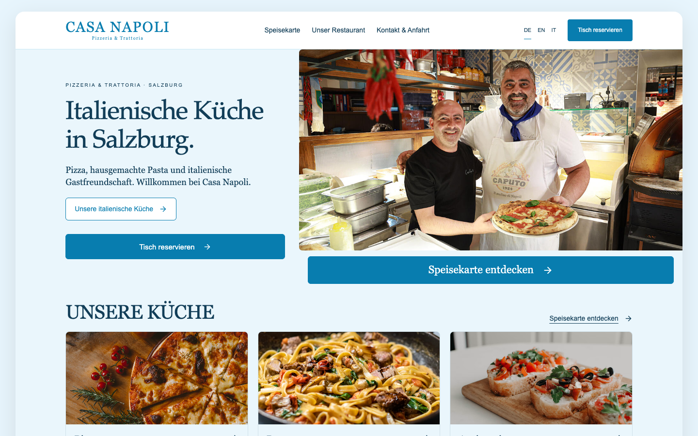
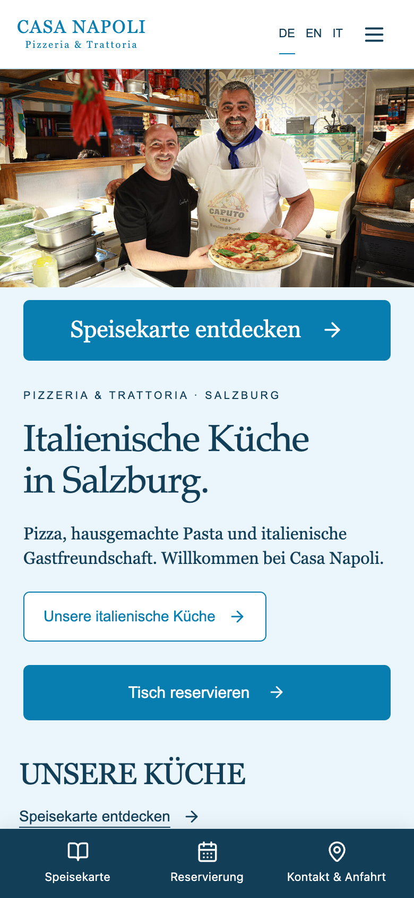
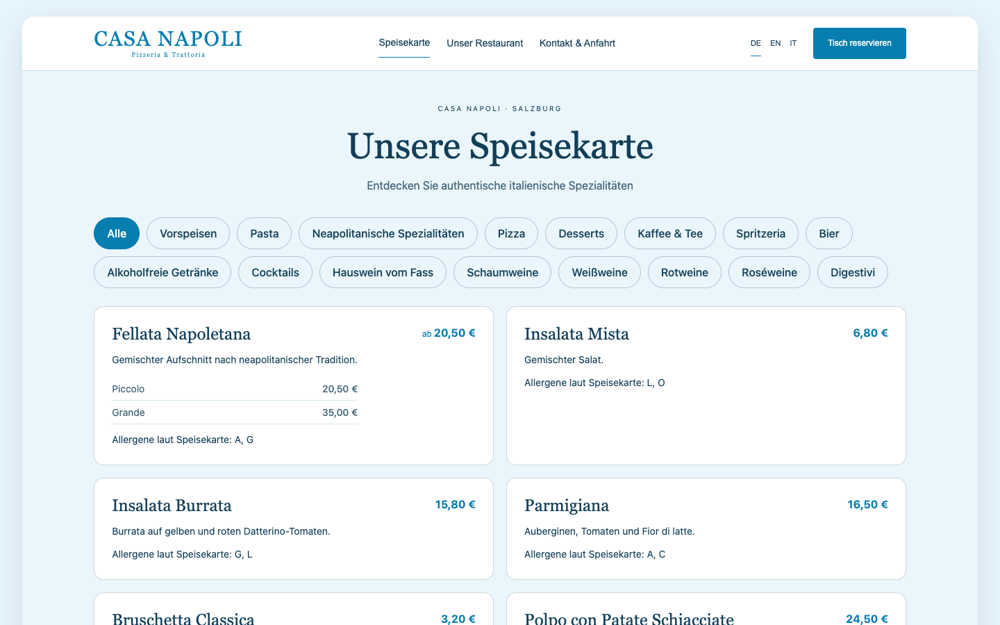
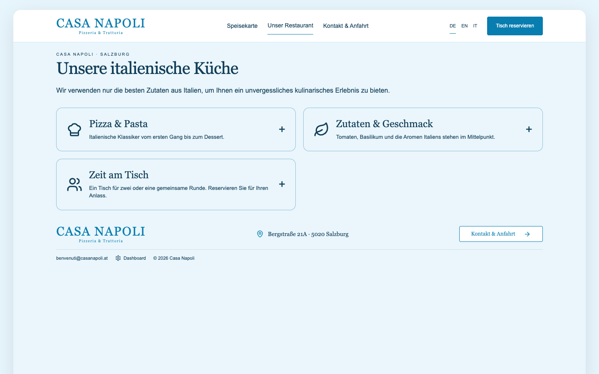
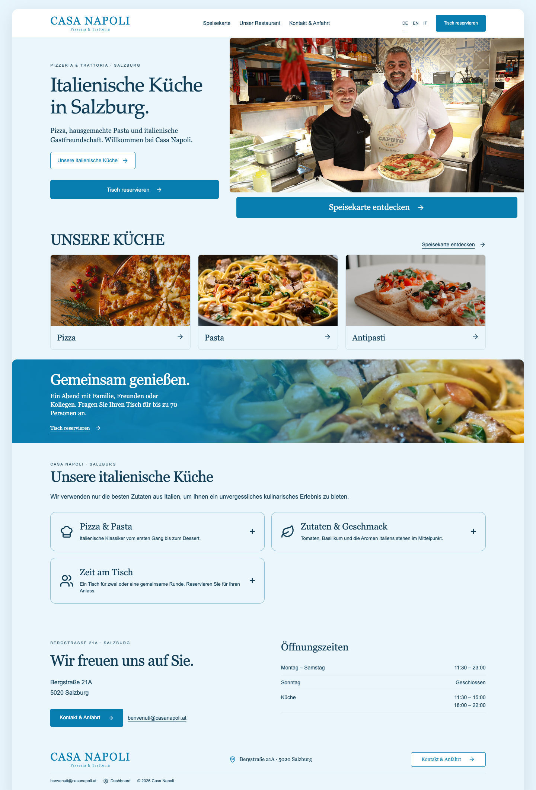

# Casa Napoli — Salzburg

> Online table reservations for a pizzeria & trattoria in Salzburg.

**Live:** [casa-napoli.at](https://casa-napoli.at/) · **Role:** Developer · **Period:** 2026 · **For:** Client (Austria)

    

## Overview

A reservation website for an Italian restaurant in Salzburg: guests check availability and book a table in German, Italian or English; the team manages bookings and the menu from an admin dashboard.

## What it does

- Table booking with live availability
- German / Italian / English
- Stripe payments
- Menu and admin dashboard

## Engineering highlights

- Rebuilt in React on the same Supabase database and Stripe setup without losing live data
- CI/CD from a private GitHub repo to the hosting

## Screenshots (live site)

  
  
  

Full home page

---

Source code is private (client / commercial project). This repository documents the work only.

Built by **Ahmed Gamal** — Senior Laravel Developer · [LinkedIn](https://www.linkedin.com/in/wzcoder/) · [GitHub](https://github.com/ahmed-gamal-dev)
